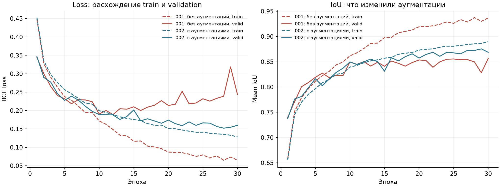
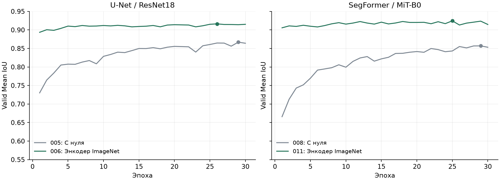
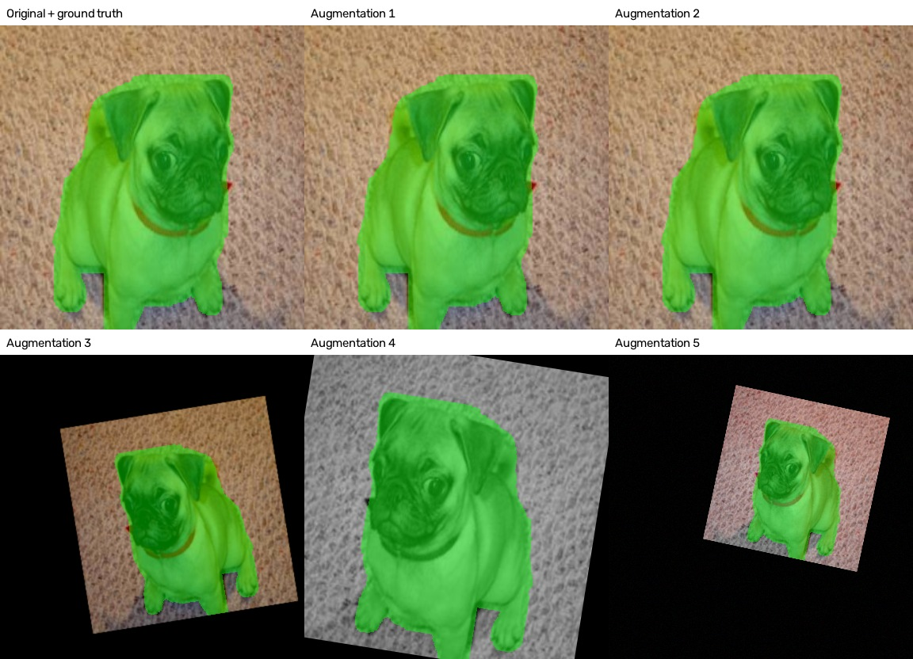
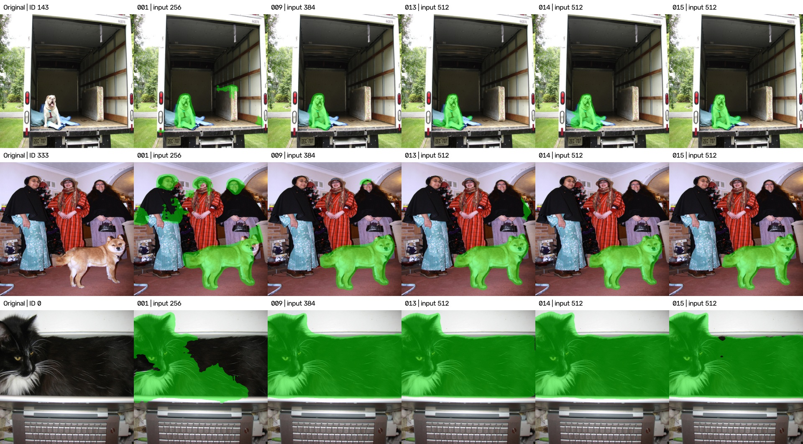
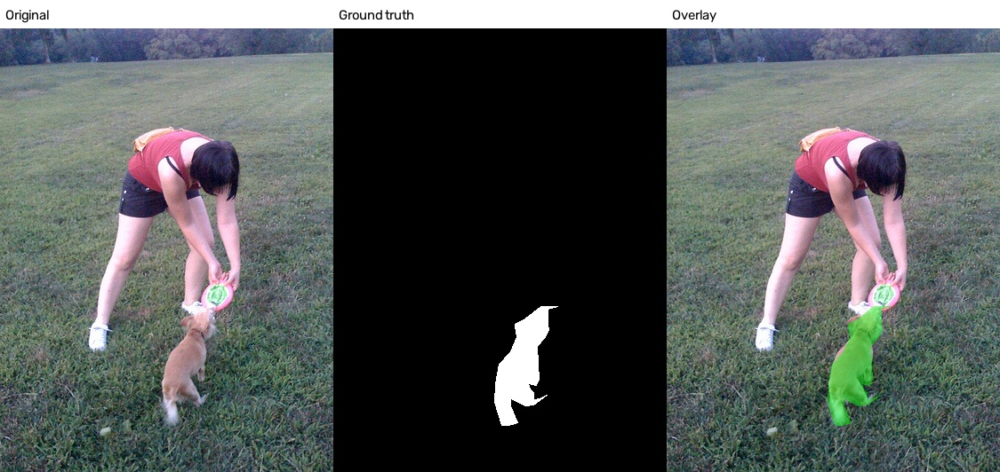

# Технический отчет решения

Начал с обычной U-Net без предобучения. Затем проверил аугментации, другие энкодеры, размер входа и функции потерь. Последние подтверждённые тестовые результаты: **0.79133 у U-Net и 0.79359 у SegFormer**. Разница небольшая, поэтому явного победителя по архитектуре пока нет.

## Данные и обучение

Использовал Oxford-IIIT Pets: **3680 изображений для обучения и 3669 для валидации**. Отдельный тест соревнования содержит **349 картинок 512×512**.

В исходных trimap-масках `1` обозначает животное, `2` фон, `3` неопределённую область у границы. Как в исходном ноутбуке, объединил `1` и `3` в один класс. Политику границы в этих экспериментах не менял.

Основные настройки: Adam, learning rate `1e-4`, seed `42`, максимум 30 эпох. Локальные логи относятся к запускам на двух GPU с DDP и батчем 4 на GPU. Предобученные энкодеры дообучались вместе с декодером. Для них нормализация ImageNet выполняется внутри модели.

Лучший чекпойнт выбирается по `valid_iou`. В поздних запусках добавил EarlyStopping: 7 валидаций без улучшения больше `0.001`. Локальный IoU усредняется по фону и животному. Валидационные маски для всех размеров входа оставлены **256×256**; предсказание при необходимости приводится к этому размеру.

## Что проверял

В таблице указан максимум valid IoU из TensorBoard. Каждая строка соответствует одному запуску, повторов с другими seed пока не было.

| № | Изменение | Лучший valid IoU |
| --- | --- | ---: |
| 001 | Своя U-Net с нуля, 256×256 | 0.85647 |
| 002 | К 001 добавлены мягкие аугментации | 0.87545 |
| 003 | 002 с BCE + Dice | 0.87498 |
| 004 | 002 с cosine scheduler | 0.87562 |
| 005 | U-Net с ResNet18 с нуля | 0.86696 |
| 006 | 005 с энкодером ImageNet | 0.91634 |
| 007 | 002 с входом 384×384 | 0.86969 |
| 008 | SegFormer B0 с нуля | 0.85691 |
| 009 | Предобученная U-Net из 006, вход 384×384 | 0.91966 |
| 010 | Предобученная U-Net из 006 с BCE + Dice, 256×256 | 0.91826 |
| 011 | SegFormer B0 с энкодером ImageNet, 256×256 | 0.92452 |
| 012 | 009 с более сильным уменьшением и смещением | 0.91662 |
| 013 | 012 с более сильными цветовыми аугментациями | 0.91685 |
| 014 | Настройки 013, но предобученный SegFormer B0 | **0.92681** |
| 015 | 013 с дополнительными кадрами людей и питомцев | 0.91941 |

### Аугментации помогли с переобучением

У первого бейзлайна train loss продолжал падать, а valid loss после примерно 12-й эпохи начал расти. К концу обучения train IoU достиг 0.93655, valid IoU остался 0.85647.

После добавления переворотов, небольших поворотов, сдвигов и изменений цвета valid IoU вырос до **0.87545**. Это **+1.90 процентного пункта**. Train стал сложнее, зато valid loss уже не рос так, как у бейзлайна.

У 001 loss восстановлен как среднее записанных batch loss одного процесса DDP. У 002 использован epoch loss с синхронизацией между GPU. Поэтому числа loss сопоставимы приблизительно; основное наблюдение здесь в форме кривых.

### Самый большой прирост дало предобучение

Для U-Net с одним и тем же ResNet18 переход от случайных весов к ImageNet поднял valid IoU с **0.86696 до 0.91634**. Для SegFormer B0 прирост составил **0.85691 → 0.92452**.

Замена архитектуры сама по себе не дала такого выигрыша. SegFormer с нуля оказался немного слабее U-Net с нуля. С предобучением обе модели стали заметно лучше.

BCE + Dice и cosine по отдельности почти не изменили качество BasicUnet относительно 002. BCE + Dice на предобученной U-Net дал небольшой рост valid IoU. Это не гарантирует такого же роста на тесте. Значения BCE и суммы BCE + Dice напрямую между собой не сравнивал.

## Почему увеличивал разрешение и усиливал аугментации

На тестовых картинках повторялись ошибки: пропускались маленькие животные и части тела, выделялись люди и лишний фон. Встречались крупные планы, тёмные и необычно окрашенные фотографии.

В 009 увеличил вход до **384×384**. Resize делается из исходной фотографии, поэтому маленькое животное сохраняет больше пикселей, чем при уменьшении до 256. Этот вариант дал около **0.77 на тесте**.

Дальше проверил две гипотезы:

- **012, масштаб и положение.** В 25% случаев картинка уменьшается до масштаба от 40 до 75% и смещается до 30% размера кадра. Ещё 25% получают прежние мягкие affine-преобразования, 50% обходятся без этого блока. Так появляются маленькие животные и животные у края. Свободные области заполняются чёрным.
- **013, цвет и освещение.** В 65% случаев выбирается одно преобразование: яркость/контраст, затемнение через gamma, RGB-сдвиг, изменение оттенка/насыщенности или перевод в серый. Геометрия остаётся как в 012.

Зелёным показана обучающая маска. Геометрия меняется вместе с ней, цветовые преобразования меняют только фотографию.

По просмотру результатов сложные случаи стали лучше. При этом valid IoU у 012 и 013 не превысил результат 009. Позднее тестовый балл вырос примерно до 0.79. Это показывает, что выбирать варианты только по среднему valid IoU было недостаточно.

## Размер входа при predict тоже влияет

Для чекпойнта 006 отдельно проверил разрешение входа и размер маски, на которой считается качество. Во всех трёх случаях использована одна и та же размеченная валидация из 3669 изображений.

| Вход модели | Маска для оценки | IoU животного | Mean IoU |
| --- | --- | ---: | ---: |
| 256×256 | 256×256 | 0.90714 | 0.91640 |
| 256×256 | 512×512 | 0.90745 | 0.91663 |
| 512×512 | 512×512 | 0.83849 | 0.85423 |

Увеличение предсказания обратно до 512 почти не изменило качество. А подача 512×512 в модель, обученную на 256×256, заметно его ухудшила. Поэтому больший размер при predict не заменяет обучение на большем размере.

## Что видно на картинках

Столбцы: оригинал, 001, 009, 013, 014 и 015. Верхняя строка показывает небольшую собаку в машине, средняя животное рядом с людьми, нижняя крупный план кота.

У бейзлайна видны лишний участок внутри машины, выделенные лица и пропущенная часть тела кота. Поздние модели убирают большую часть этих ошибок. Но на отдельных изображениях остаются лишние области и неточные границы.

Это сравнение готовых submission. В заголовках указан фактический размер входа: условия predict у этих файлов различаются. Правильных тестовых масок у нас нет, поэтому картинками нельзя подтвердить точный прирост IoU или посчитать качество отдельных случаев.

## Дополнительные примеры с людьми

Для 015 подготовил внешнюю подборку COCO train2017, поскольку дополнительные данные разрешены правилами соревнования. После проверки осталось **371 изображение**:

- **184** с человеком и кошкой или собакой. Маска выделяет только питомца.
- **187** отрицательных примеров с людьми, без аннотированных классов животных COCO. Маска пустая.

Маски получены из готовых полигонов COCO. Первую подборку из val2017 отклонил: она пересекалась с тестом соревнования. Для новой подборки совпадений по перцептивным хешам с 7390 Oxford-фотографиями и 349 тестовыми кадрами не найдено. ID также не пересекаются с COCO val2017. Проверка хешами не исключает все возможные сильно изменённые копии.

При проверке отбора нашлись кадры с овцами, лошадьми и другими животными, которым скрипт назначал фон. Такие 29 кадров исключил. Внешние примеры добавляются только в train, валидация остаётся прежней.

У 015 valid IoU составил **0.91941**. Подтверждённого тестового балла для него пока не записано, поэтому вывод о пользе этих данных делать рано.

## Тестовый результат и оставшиеся проблемы

Последние точные баллы, полученные после отправки submission:

| Модель | Тестовый IoU |
| --- | ---: |
| U-Net | 0.79133 |
| SegFormer B0 | **0.79359** |

SegFormer впереди на **0.00226**, или **0.226 процентного пункта**. Это результат конкретных отправок, а не доказательство устойчивого преимущества архитектуры. Точная привязка этих двух баллов к CSV в локальных метаданных пока не сохранена.

Высокая валидация не перенеслась на тест целиком. По просмотру видно, что модели ещё ошибаются на людях, одежде, маленьких и частично видимых животных. Но показатели по отдельным группам пока не посчитаны, поэтому причину разрыва `~0.92 -> ~0.79` нельзя считать установленной.
